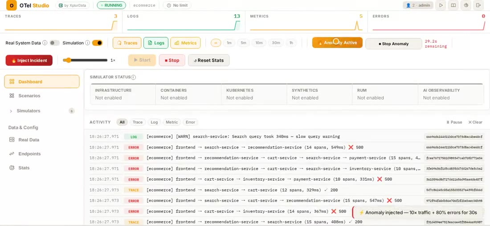

<p align="center">
  
</p>

<h1 align="center">OTel Studio</h1>

<p align="center">
  A free, MIT-licensed, self-hosted OpenTelemetry data generator.<br>
  Realistic correlated traces, logs and metrics over OTLP — for any OpenTelemetry-compatible backend, with no application to deploy.
</p>

<p align="center">
  <a href="https://otel-studio.xplurdata.com">Live Site</a> ·
  <a href="https://otel-studio.xplurdata.com/documentation.html">Documentation</a> ·
  <a href="https://otel-studio.xplurdata.com/guides/index.html">Guides</a> ·
  <a href="https://xplurdata.com">XplurData</a>
</p>

<p align="center">
  
  
  
  <a href="https://github.com/xplurdata/otel-studio/pkgs/container/otel-studio"></a>
  
  
</p>

<p align="center">
  <a href="https://otel-studio.xplurdata.com"></a>
</p>

---

## Where OTel Studio fits

Testing an observability pipeline, alert or dashboard needs data that looks like production. Different tools suit different jobs:

| Tool | Best for |
|---|---|
| `telemetrygen` | A quick command-line stream of simple spans, logs or metrics |
| The OpenTelemetry Demo | A complete, instrumented demo shop to explore OpenTelemetry end to end |
| k6 / Gatling | Load-testing HTTP services themselves |
| Hand-written scripts | One-off checks for a single case |
| **OTel Studio** | Realistic, correlated traces, logs and metrics from many services, hosts, clusters and users, with a UI, anomaly injection and a command-line mode for CI |

Drop in a Docker image, point it at your Collector or backend, and see correlated data in about a minute. See the guide [How to generate OpenTelemetry test data](https://otel-studio.xplurdata.com/guides/generate-opentelemetry-test-data.html) for when to use which.

## Features

- **30 realistic service topologies** — actual parent-child request chains across Web App, Infrastructure, APM, Cloud Native, Chaos/Stress and GenAI categories, not random noise
- **Six simulators sharing one estate** — hosts (20 to 2,000), containers, Kubernetes, synthetic checks, browser sessions (RUM) and AI/LLM workloads, all correlated by shared identities
- **Anomaly and incident injection** — a traffic and error burst, or one degraded host with matching symptoms across traces, metrics and logs
- **Quick-start templates, a volume estimator and speed up to 10×** for load and cardinality tests
- **Correlated signals** — logs share trace IDs with the spans that produced them
- **Chaos scenarios** — dedicated error-storm, cardinality-burst, and latency-spike modes for testing alerting and dashboards
- **Multi-endpoint fanout** — send to two or more OTel backends (e.g. Grafana + Elastic) simultaneously, with independent TLS/mTLS per endpoint
- **Geo / IP simulation** — tag generated telemetry with realistic regional IP ranges and GeoIP-resolvable attributes, or safe RFC 5737 test ranges
- **Synthetic PII** — opt-in, per-scenario synthetic user data (RFC 2606 reserved domains only) for testing redaction/DLP pipelines
- **Advanced scenario controls** — custom attributes, span duration overrides, weighted status codes
- **Real system data** — optionally tail real log files and Docker container logs/metrics alongside simulated traffic
- **Bearer token and request headers** per endpoint, stored encrypted and never shown again; OTLP over gRPC, HTTP protobuf or HTTP JSON
- **Command-line mode and Job API** — run headless in CI or start and stop runs from another application; standard `OTEL_EXPORTER_OTLP_*` variables are read
- **One-click stack presets** — Grafana Alloy, OpenTelemetry Collector, Elastic APM, Honeycomb, Jaeger, SigNoz, OpenObserve, Datadog, New Relic and Dynatrace

## Quick Start

```bash
docker run -d --name otel-studio -p 3002:3002 \
  -e OTEL_ENDPOINT="http://your-collector:4317" \
  -e OTEL_PROTOCOL="grpc" \
  -e ADMIN_PASS="change-me" \
  ghcr.io/xplurdata/otel-studio:latest
```

Open `http://localhost:3002`, log in, pick a scenario, hit Start. There is no built-in destination: set `OTEL_ENDPOINT` as above, or add one on the **Endpoints** page, which also takes a bearer token and extra headers.

Full setup, environment variables, and every feature documented at **[otel-studio.xplurdata.com/documentation.html](https://otel-studio.xplurdata.com/documentation.html)**.

## Images

Both images are published for `linux/amd64` and `linux/arm64`.

| Tag | Contents |
|---|---|
| `latest`, `2.0.0` | OTel Studio only (about 290 MB). Use this one. |
| `latest-browser`, `2.0.0-browser` | The same plus Chromium (about 1.1 GB), for real-browser RUM only. |

## Guides

- [Test your OpenTelemetry Collector configuration before production](https://otel-studio.xplurdata.com/guides/test-otel-collector-configuration.html)
- [Test alert rules and SLO burn rates with injected failures](https://otel-studio.xplurdata.com/guides/test-alerts-and-slos.html)
- [Send OTLP to secured backends: tokens, headers, TLS and mTLS](https://otel-studio.xplurdata.com/guides/secure-otlp-endpoints.html)
- [Run OTel Studio in CI](https://otel-studio.xplurdata.com/guides/otel-studio-in-ci.html)
- [OpenTelemetry data not showing up? A checklist](https://otel-studio.xplurdata.com/guides/troubleshoot-missing-opentelemetry-data.html)

All guides: [otel-studio.xplurdata.com/guides](https://otel-studio.xplurdata.com/guides/index.html).

## Security

The image runs as a non-root user and contains only the compiled, minified application, with no source files. Credentials entered in the UI are stored encrypted and never shown again. To report a vulnerability, see [SECURITY.md](SECURITY.md).

## License

Free to use, including commercially, under the MIT licence — see [LICENSE](LICENSE).

Product names mentioned are trademarks of their respective owners. OTel Studio is not affiliated with or endorsed by them.

---

<p align="center">
  Built by <a href="https://xplurdata.com"> XplurData</a>
</p>
